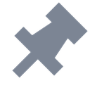
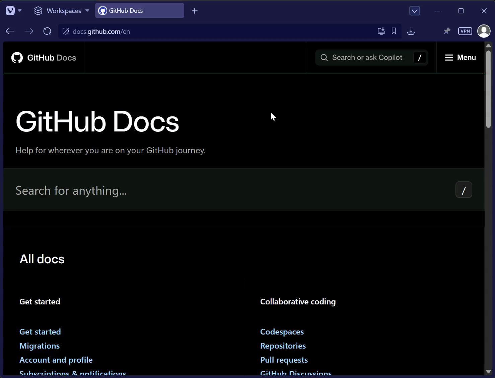
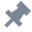
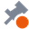

#  pinned-home

Arc-style pinned tabs for Chromium browsers. A pinned tab remembers the URL it was pinned on, and one shortcut resets the tab to that original URL. The toolbar icon shows when the tab has left it. Tested in Vivaldi, Chrome and Edge on Windows. Uses only standard extension APIs and needs no access to page content.

## Why

Pinned tabs hold the pages you keep open all day: mail, a task tracker, a dashboard. Over a working day such a tab drifts 20 or 30 pages away from where it started, and the way back is retyping the address or digging through history. Arc gave every pinned tab a home URL and a shortcut back to it. Chrome, Edge and Vivaldi have pinned tabs, but nothing that takes one back to where it started.

## Install

1. Download `pinned-home-<version>.zip` from the [latest release](https://github.com/Gusarovv/pinned-home/releases/latest) and unzip it into a folder you will keep.
2. Open the extensions page (`chrome://extensions`, `edge://extensions` or `vivaldi://extensions`), enable Developer mode, click **Load unpacked** and choose that folder.
3. If the browser puts the extension icon in the extensions menu, pin it to the toolbar: the away indicator lives on that icon.

Tabs that are already pinned take their current URL as home. If one of them is not on its start page, unpin it and pin it again there.

To update, replace the folder contents with the new release and click **Reload** on the extension.

## Usage

| Action | How |
| --- | --- |
| Return the pinned tab to its home URL | Alt+R or click the toolbar icon |
| Open the current page in a new tab and return the pinned tab home | Alt+Shift+D |
| Change the home URL | Unpin and pin again |

| Toolbar icon | Meaning |
| --- | --- |
|  | The active pinned tab is on its home URL, or the active tab is not managed |
|  | The active pinned tab has left its home URL, a click returns it |

If the active tab is not managed (not pinned or not an http(s) page), a shortcut or a click on the toolbar icon shows a `?` badge for two seconds.

Shortcuts can be changed at `chrome://extensions/shortcuts` (`edge://` and `vivaldi://` in those browsers). If a shortcut does nothing, check that it is assigned there: Chromium does not auto-assign shortcuts it reserves for itself.

## Limitations

- The indicator follows the active tab only, because an extension has one toolbar button per window.
- The extension does not run in private windows.
- If a site rewrites its URL on load (login redirects, `replaceState`), the dot stays after Alt+R. Pin the page on its final URL instead.
- Vivaldi's "Restrict Pinned Tab to Current Site" blocks a reset to a home URL on another domain, for example after a login redirect, and opens it in a new tab instead. Turn the option off for such tabs from the tab context menu.

## Development

Build from source with Node.js 22.18 or newer: `npm install`, then `npm run build`, and load `dist/` as described in Install. After pulling changes, rebuild and click **Reload** on the extension. Checks: `npm run typecheck` and `npm test`. The icons are generated by `python3 scripts/icons.py`, which needs Pillow.

The extension was written with the help of an AI coding assistant.

## License

[MIT](LICENSE)
